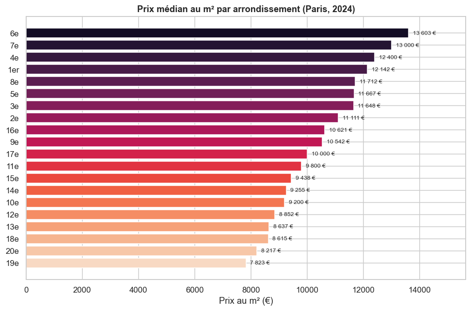
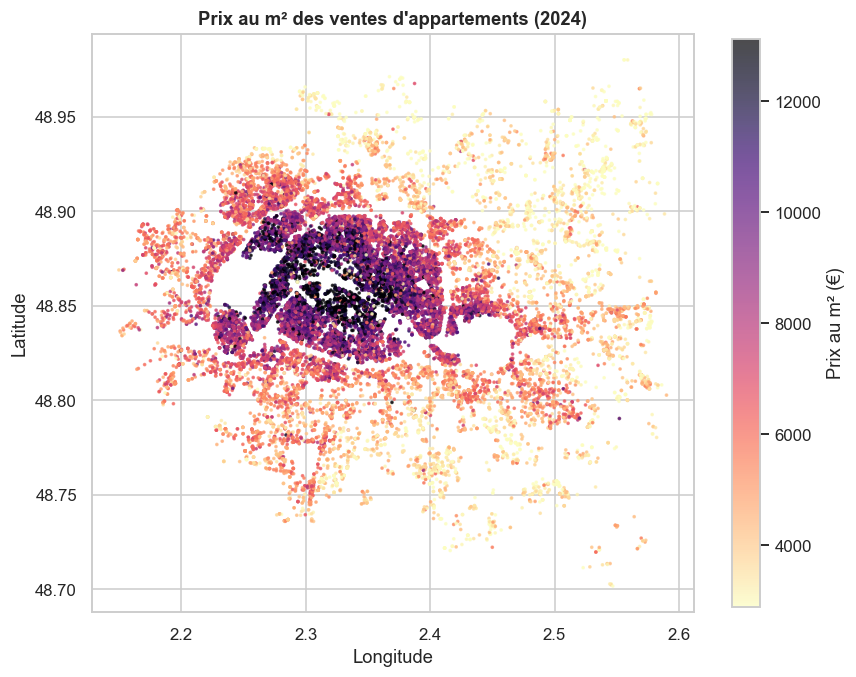
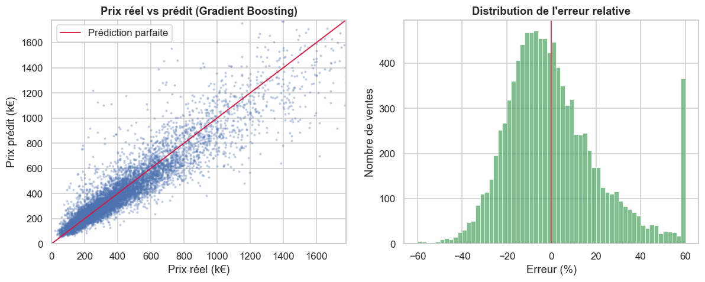
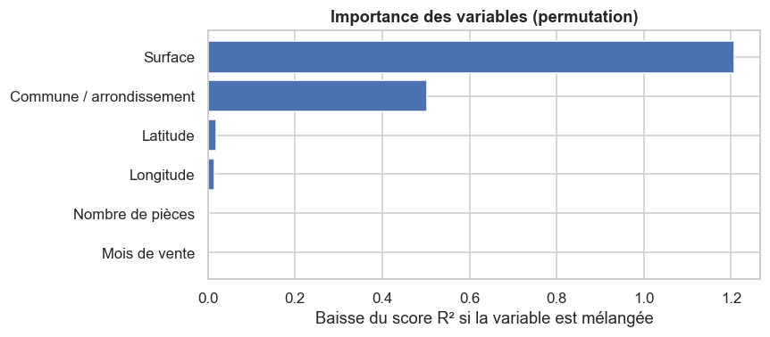

# Prix de l'immobilier à Paris et en petite couronne — analyse et prédiction

Projet de **Data Analytics et Machine Learning** réalisé par [Fatou Sarr](https://sarr-fatou.github.io/) (Master 1 MIAGE — Data, IA & Big Data).

**Question métier :** combien vaut un appartement à Paris et en petite couronne, et quels facteurs expliquent son prix ?

👉 **[Voir le notebook complet](notebooks/analyse_immobilier_idf.ipynb)** : code, graphiques et explications.

## Données

[Demandes de Valeurs Foncières (DVF)](https://www.data.gouv.fr/fr/datasets/demandes-de-valeurs-foncieres-geolocalisees/) 2024, publiées par la DGFiP (version géolocalisée par Etalab) : toutes les ventes immobilières de Paris (75), des Hauts-de-Seine (92), de la Seine-Saint-Denis (93) et du Val-de-Marne (94).

| Étape de nettoyage | Volume |
|---|---|
| Lignes brutes | 229 275 |
| Ventes uniquement | 81 928 mutations |
| Ventes d'un seul appartement (dépendances acceptées) | 54 171 |
| Valeurs renseignées et coordonnées GPS valides | ≈ 53 700 |
| **Après retrait des valeurs aberrantes** | **51 200** |

## Résultats de l'analyse

| Département | Prix médian au m² |
|---|---|
| Paris | **9 553 €** |
| Hauts-de-Seine | 6 395 € |
| Val-de-Marne | 4 696 € |
| Seine-Saint-Denis | 4 000 € |



- À Paris, le prix au m² médian va de **7 823 €** (19e) à **13 603 €** (6e), soit un écart de 1,7.
- Le prix au m² va **du simple au plus du double** entre la Seine-Saint-Denis et Paris.
- Les **petites surfaces** sont plus chères au m².



## Modèle de prédiction du prix

On prédit le prix de vente à partir de la surface, du nombre de pièces, de la commune, des coordonnées GPS et du mois. Les modèles sont entraînés sur 80 % des ventes et évalués sur les 20 % restants.

| Modèle | Erreur absolue moyenne | Erreur médiane | R² (log) |
|---|---|---|---|
| Référence : prix médian de la commune × surface | 72 100 € | 14,2 % | 0,861 |
| Régression linéaire (Ridge) | 96 900 € | 17,6 % | 0,807 |
| Random Forest | 68 300 € | 12,9 % | 0,875 |
| **Gradient Boosting** | **67 100 €** | **12,9 %** | **0,880** |



**Lecture honnête des résultats :**
- Le Gradient Boosting est le meilleur modèle, mais il ne fait que **légèrement mieux** que la règle simple « prix médian du quartier × surface ».
- 57 % des prix prédits sont à moins de 15 % du prix réel.
- Les données DVF ne décrivent pas l'**état du bien**, l'étage, l'ascenseur, le balcon ou le DPE. Pour améliorer la précision, il faut **ajouter ces informations**, plutôt que complexifier le modèle.



## Compétences mobilisées

- **Nettoyage de données réelles** : regroupement par vente, filtrage des ventes complexes, gestion des valeurs aberrantes et des erreurs de géolocalisation.
- **Analyse exploratoire** : distributions, comparaisons géographiques, saisonnalité (pandas, matplotlib, seaborn).
- **Machine Learning** : séparation entraînement / test, pipeline scikit-learn (standardisation, encodage one-hot), comparaison de modèles à une référence, métriques (MAE, MAPE, R²), importance des variables par permutation.

## Lancer le projet

```bash
pip install -r requirements.txt
python src/download.py          # télécharge les données DVF 2024 (~5 Mo)
jupyter notebook notebooks/analyse_immobilier_idf.ipynb
```

## Pistes d'amélioration

- Ajouter des données externes : distance au métro (open data Île-de-France Mobilités), revenus par quartier (INSEE), DPE (ADEME).
- Étendre à plusieurs années pour mesurer l'évolution des prix.
- Déployer le modèle dans une petite application d'estimation.
